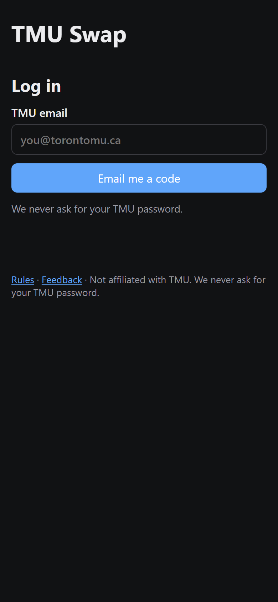
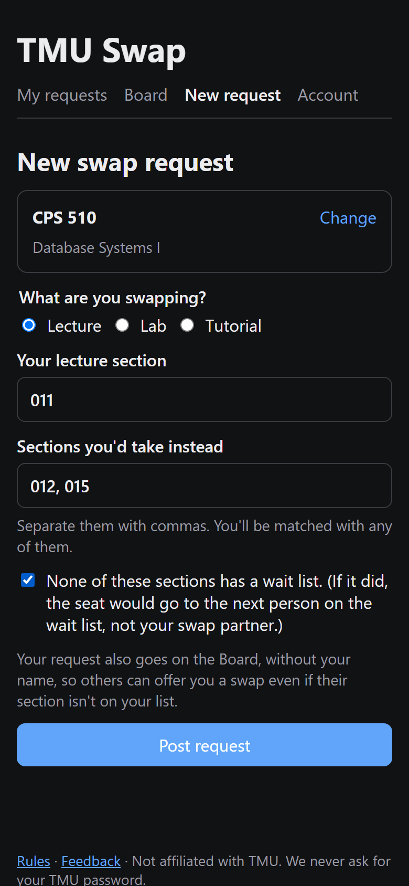
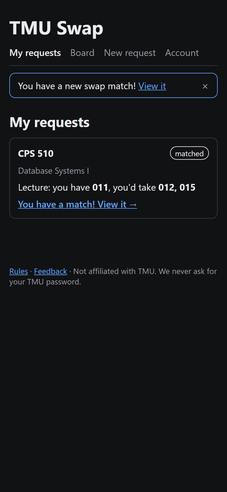
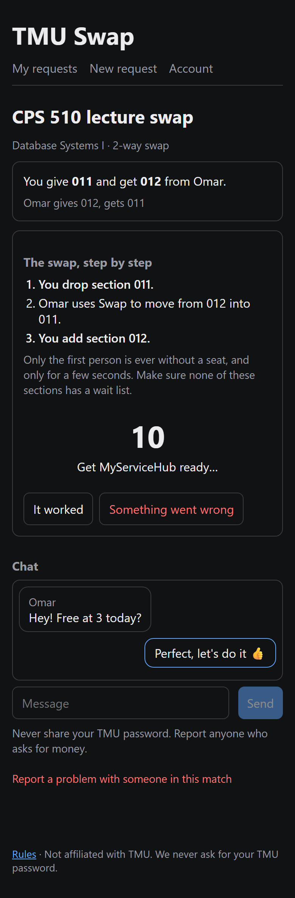
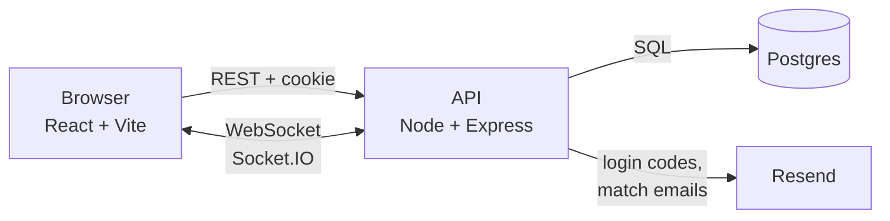

# TMU Swap

[](https://github.com/zaidhawk/TMUswap/actions/workflows/ci.yml)
[](https://codecov.io/gh/zaidhawk/TMUswap)

A section-swap platform for Toronto Metropolitan University students. Post the section you have and the ones you'd take, get matched automatically (including 3-way swaps), then chat and run a shared countdown so everyone makes their change in MyServiceHub at the same moment.

**Live:** [swap.zaidhaque.ca](https://swap.zaidhaque.ca)

<p>
  
  
  
  
</p>

## Why

Section swaps happen in Reddit threads and Discord servers today. Posts get buried, nobody verifies who's a real student, and swaps fail when a stranger grabs the seat between the drop and the add. TMU Swap fixes all three: TMU-only accounts, automatic matching, and a server-timed countdown so the drop and add happen seconds apart.

## Features

- **TMU-only, passwordless login.** A 6-digit code sent to an `@torontomu.ca` address. Codes are HMAC-hashed, expire in 10 minutes, allow 5 attempts, and are limited to 3 per hour.
- **Automatic matching.** Direct swaps first, then 3-way cycles, oldest requests first. Runs the moment a request is posted, plus a safety sweep every 30 minutes.
- **Accept within 24 hours**, or the match expires and everyone else goes back into the pool.
- **Board with direct offers.** Every open request is listed (without names) and searchable by course. If your section isn't on someone's list, offer it anyway; if they accept, you're matched straight into the chat. Accepting locks both requests in the same order as the matcher, so an offer and an automatic match can't claim the same seat.
- **Real-time chat** per match over WebSockets, with typing indicators.
- **Shared countdown.** It starts only when everyone has pressed Start, using the server's clock, so every phone says "Go!" at the same moment. It's paused during MyServiceHub's nightly maintenance (11:45 pm to 1:15 am).
- **Step-by-step plan.** Who drops first, who uses Swap into which freed seat, and who adds last. Only one person is ever without a seat, for a few seconds.
- **Safety.** A report button in every match, and an automatic admin alert when a chat mentions money (selling seats is banned).
- **Privacy.** Other students only see your display name. Chats are deleted 30 days after a match ends, and you can delete your account at any time.
- **3,721 courses** across all 116 subjects in TMU's 2026–27 undergraduate calendar, from accounting to nursing. Students type their own section numbers, so new sections need no setup.
- **Feedback from any page.** Each message reaches the admin with the page it came from and the browser used, so bugs can be reproduced.
- **Admin stats.** Sign-ups, requests, matches and completed swaps, all time and per day, from anonymous counts.

## How it works



| Part | Tech | Hosted on |
| --- | --- | --- |
| Web app | React 19, TypeScript, Vite, React Router | Vercel |
| API and live updates | Node 24, Express 5, Socket.IO, Zod | Render |
| Database | PostgreSQL 16, Drizzle ORM and migrations | Neon |
| Email | Resend | |

**Matching.** Open requests form a directed graph: an edge A → B means B has a section A wants. A direct swap is a cycle of length 2, found with a single SQL query. A 3-way swap is a cycle of length 3, found in memory over that course's open requests ([`cycles.ts`](api/src/matching/cycles.ts)).

**No double-booking.** Reserving a match happens in one transaction that locks the requests (`SELECT … FOR UPDATE`), re-checks they're still open and still want each other, and only then creates the match. Rows are always locked in the same order, so two transactions can't deadlock ([`engine.ts`](api/src/matching/engine.ts)).

**Sessions.** A random 256-bit token in an `httpOnly`, `Secure`, `SameSite=Lax` cookie. The database stores only its SHA-256 hash, so a leaked table can't be used to log in. The web app and API share the `zaidhaque.ca` site, which is what lets the cookie work.

## Testing

Three layers, all run by GitHub Actions on every pull request. A pull request can't merge until all three pass.

| Layer | Tool | What it covers |
| --- | --- | --- |
| Unit | Vitest | Triangle search, swap step order, the maintenance window across EST and EDT |
| API | Vitest + Supertest against a real Postgres | Every route's happy path, login required, non-members get 403, rate limits, two matches racing for the same request, WebSocket auth, rooms and chat |
| End-to-end | Playwright | Two browsers sign up, post opposite requests, get matched live, accept, chat, check one press doesn't start the countdown, both press, see "Go!", and complete the swap |

**220 unit and API tests** plus 4 end-to-end tests, with about 94% line coverage.

Two practices worth calling out:

- **Testing the tests.** For every safety rule (membership checks, rate limits, row locks, the countdown rules), I deleted the rule on purpose and confirmed a test failed. This caught a race-condition test that passed even without the lock, because the race never actually happened. It now holds a lock from a second connection so both matchers are guaranteed to collide.
- **No flaky clocks.** Rules that depend on the time of day use an injectable clock, so the suite passes no matter when CI runs.

## Running it locally

You need Node 24 and Docker Desktop.

```bash
npm install
docker compose up -d          # Postgres on localhost:5432
npm run db:migrate -w api     # create the tables
npm run db:seed -w api        # load the course list (api/data/courses-2027W.csv)
npm run dev -w api            # API on http://localhost:3000
npm run dev -w web            # web app on http://localhost:5173 (in a second terminal)
```

Login codes are printed in the API's terminal instead of emailed.

| Command | What it does |
| --- | --- |
| `npm run lint` / `npm run typecheck` | Static checks for every package |
| `npm test` | Unit and API tests (needs Docker running) |
| `npm run test:coverage -w api` | The same, with a coverage report in `api/coverage` |
| `npm run e2e` | Playwright end-to-end tests against production builds |
| `SCREENSHOTS=1 npm run e2e -- screenshots` | Regenerates the screenshots above |

```
api/   Express API, Socket.IO, matching engine, Drizzle schema and migrations, tests
web/   React app
e2e/   Playwright end-to-end tests
```

## Admin

**Stats:** accounts listed in the `ADMIN_LOGINS` environment variable (comma-separated `@torontomu.ca` emails) get a **Stats** page at `/admin`: sign-ups, requests, matches and completed swaps, all time and for the last 14 days. It only shows counts, never who. Sign-ups and requests are recorded as anonymous events, so the totals don't drop when someone deletes their account. To try it locally, start the API with `$env:ADMIN_LOGINS="you@torontomu.ca"` set in the same PowerShell window.

Reports and money alerts are emailed to the admin. To act on one, run SQL in the Neon console.

```sql
-- Ban a user: they're logged out everywhere, can't log back in, and their open requests close.
UPDATE users SET is_banned = true WHERE email = 'someone@torontomu.ca';
DELETE FROM sessions WHERE user_id = (SELECT id FROM users WHERE email = 'someone@torontomu.ca');
UPDATE swap_requests SET status = 'cancelled'
  WHERE status = 'open' AND user_id = (SELECT id FROM users WHERE email = 'someone@torontomu.ca');

-- Mark a report as handled (the id is in the email).
UPDATE reports SET resolved_at = now() WHERE id = '<report id>';
```

## TMU policy

TMU Swap is a student project and is **not affiliated with Toronto Metropolitan University**. It never touches MyServiceHub and never asks for TMU passwords: each student makes their own change by hand. Swaps are free and one-for-one, and wait-listed sections aren't allowed, because TMU gives a freed wait-listed seat to the next person on the list.
